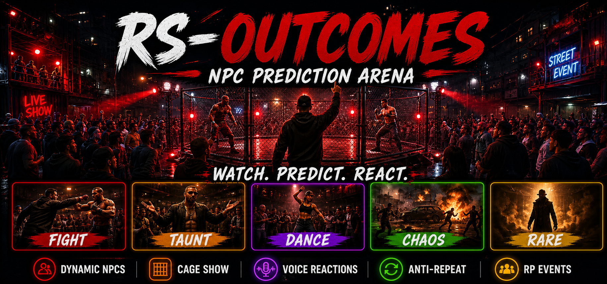

# RS-OUTCOMES — NPC Prediction Arena

<!-- RS community links -->

Free NPC prediction-arena roleplay for FiveM community events, with performers, reactions and crowd moments. RP entertainment only.

[Website](https://realitysucksrp.github.io/) | [Tebex Store](https://reality-sucks-rp-webstore.tebex.io/) | [Free Scripts](https://reality-sucks-rp-webstore.tebex.io/category/free-scripts) | [Discord](https://discord.gg/e9V3rPHySx) | [YouTube](https://www.youtube.com/@RealitySucksRP)

<!-- /RS community links -->



<p align="center">
  <a href="https://reality-sucks-rp-webstore.tebex.io/category/free-scripts"></a>
  <a href="https://reality-sucks-rp-webstore.tebex.io/"></a>
  <a href="https://realitysucksrp.github.io/"></a>
  <a href="https://discord.gg/e9V3rPHySx"></a>
</p>

> I build my own FiveM systems and complete server setups including shops, weapons, phones, racing, customs, garages, dealerships, zombie apocalypse systems, warfare, Phantom encounters and custom UI.

Turn your city into a live underground street spectacle.

RS-Outcomes is an NPC-driven FiveM RP event resource where players gather around a cage arena, predict chaotic NPC outcomes, watch the show unfold live and react to performer, reactor and crowd moments.

Built for immersive city events, nightlife districts, gang territory RP, streamer events, community nights and public social hubs.

> **RP ENTERTAINMENT ONLY**
>
> This resource must not be connected to real money, cryptocurrency, paid currency or anything with real-world value.

## Open Source and Community Friendly

RS-Outcomes / RS-OutcomeBets is released as an open-source community resource.

You are encouraged to add outcomes, create NPC reactions, build new arenas, improve the UI, expand framework support and share improvements with the community.

Please keep credit to the original creator:

**Original Creator:** Reality Sucks RP / William Brito  
**Original Resource:** RS-Outcomes / RS-OutcomeBets

Licensed under the [BSD 3-Clause License](LICENSE).

## Framework Support

- QBCore
- Qbox
- Standalone
- ESX support through RS Bridge when installed separately

## Features

### Live NPC Prediction Shows
Players gather around a cage arena and predict what the performer NPC will do next.

Outcome styles include fights, taunts, dance-offs, intimidation, comedy reactions, chaos moments, cinematic outcomes, street-action scenes and strange wildcard moments.

### Smart Outcome Director
The director tracks recent outcomes and rotates action styles to reduce repetitive shows and predictable pacing.

### Dynamic NPC Reactions
Reactor NPCs can panic, laugh, stumble, taunt back, oversell hits, fake surrender, collapse dramatically and recover differently after rounds.

### Voice Reaction System
Supports OGG performer, reactor and crowd callouts that server owners can replace or expand.

### Underground Cage Atmosphere
Includes cage-event presentation, event NPCs, crowd NPCs, lighting, markers and a dedicated UI.

### Configurable RP Participation
Server owners control entry settings, round handling, duplicate-result protection, one-entry-per-round behavior and optional NPC assist for low-pop servers.

## Customization

Server owners can configure:

- Rounds and outcome branches
- NPC models and animations
- Reaction pools and voice lines
- Event timing
- Arena locations and cage size
- Crowd size and lighting
- UI behavior
- Cooldowns and anti-repeat behavior
- NPC assist settings

## Install

1. Drop `rs-outcomebets` into your resources folder.
2. Add:

```cfg
ensure rs-outcomebets
```

3. Configure framework and arena settings in `shared/config.lua`.
4. Restart the resource and test on a dev server before using it live.

## Commands

```txt
/betstart                         Start a popup arena
/betstart fixed                   Start the default fixed arena
/betstart fixed id                Start a configured fixed arena
/betmenu                          Open the UI near a show
/betforce [round] [outcomeId]     Dev-test an outcome
/betend                            End hosted show and refund active entries
/betcancel                         Cancel hosted show and refund active entries
```

## Important Notice

This resource is designed for FiveM roleplay entertainment only.

Do not use it with real money, cryptocurrency, paid currency, anything with real-world value or real gambling systems.

Server owners are responsible for configuring it in a way that follows platform rules, local laws, Tebex policies and Cfx.re/FiveM policies.

## Complete FiveM Servers For Sale

I love making scripts and running wild in GTA, but I also enjoy building complete servers. I use tested RealitySucksRP systems and configure the build around the owner's gameplay, framework, economy, theme and direction.

- **QBCore Shell — $500**
- **Zombie Server — $700**
- **Full RP Server — $850**
- **30 days of Discord setup/support included**

**Website:** https://realitysucksrp.github.io/

**Tebex:** https://reality-sucks-rp-webstore.tebex.io/

**Discord:** https://discord.gg/e9V3rPHySx

---

**Watch the show. Predict the outcome. Create the RP moment.**